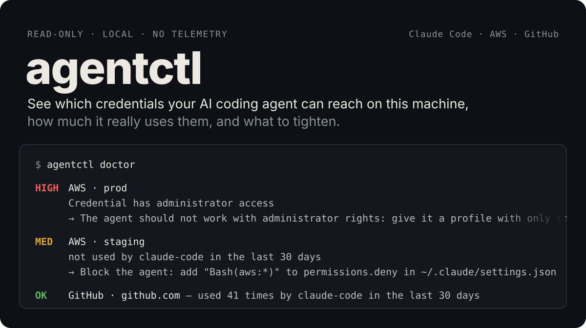
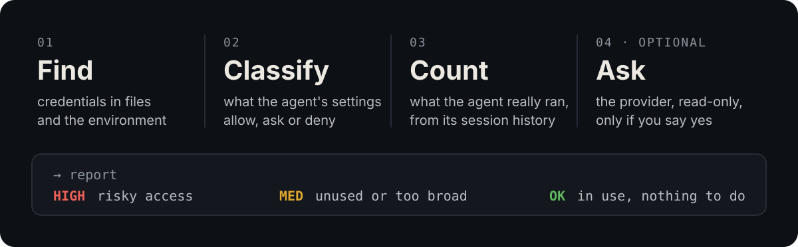

<p align="center">
  
</p>

AI coding agents run on machines that hold logged-in command-line tools and long-lived credentials. `agentctl` shows, read-only and on your own machine, what the agent can reach: which cloud and code-hosting credentials exist, whether the agent is allowed to use them, how much it actually does, and what to tighten.

Supported today: one agent (Claude Code) and five tools (AWS, GitHub through `gh`, the Docker socket, kubectl contexts, and Claude Code MCP servers), on macOS and Linux, on laptops and on servers.

## What a run looks like

This is `agentctl doctor --offline` on a machine with one AWS profile and a `gh` login. The names are examples; the format is the program's own plain-text output.

```text
$ agentctl doctor --offline
agentctl doctor - 30 days - offline

SEV  TOOL    NAME        AGENT    USED 30d  CHECKED  ISSUE
-----------------------------------------------------------------
MED  AWS     staging     allowed  0         offline  unused
MED  agent   shell       allowed  -         -        unrestricted
OK   GitHub  github.com  allowed  41        offline  -

Fix
  1  deny "Bash(aws:*)" in ~/.claude/settings.json
  2  revoke a credential you do not use yourself
  3  restrict the agent's shell, or use a sandbox

Notes
  deny rules are advisory without a sandbox
  launch flags are not detected
```

The picture at the top is abridged. A HIGH finding such as administrator access needs an online check, because only the provider knows what a credential can do.

## Why it is built this way

- **It only looks.** It changes no file, keeps no state between runs, and has no telemetry and no update check. There is no `agentctl fix`.
- **Names, never values.** It reports profile names, variable names, tool names and counts. A secret value is not copied into output, logs, or error messages, and access key IDs are masked.
- **It asks before it goes online.** Every provider call is read-only and has a timeout. It lists the providers first and asks once; answer `n` and nothing leaves the machine.
- **It says when it could not check.** A file it could not read, history it could not attribute, or permissions it could not list appear as notes. It does not turn them into "unused" or "not admin".
- **It does not recommend revoking on a guess.** Shell history can show that you use a tool, never that you do not. Revoking is recommended only when the provider itself shows no use in the window.

## How it works

<p align="center">
  
</p>

1. **Find.** It reads the places where credentials are configured: `~/.aws`, the `gh` hosts file, and environment variables.
2. **Classify.** It reads Claude Code permission settings and decides, for each credential, whether the agent is allowed without asking, asks first, or is denied.
3. **Count.** It reads Claude Code session history under every project and counts the agent's `aws` and `gh` commands in the window. It reads your shell history to learn whether you use the tool yourself.
4. **Ask (optional).** Online, it asks AWS for identity, attached policies and access key last use, and GitHub for the token's user and scopes.

## Install

From source, with Go 1.24 or newer:

    go install github.com/VSN2015/agentctl/cmd/agentctl@latest

Or download an archive for your OS and CPU, check it, and unpack it:

    shasum -a 256 -c SHA256SUMS --ignore-missing
    tar -xzf agentctl_<version>_<os>_<arch>.tar.gz

(On Linux, `sha256sum -c SHA256SUMS --ignore-missing` does the same.) Each archive holds `agentctl`, `LICENSE`, and `README.md`. On Linux the binary is statically linked; on macOS it links the system libraries. It has no runtime dependencies.

## Use

    agentctl inventory    # what credentials exist and what the agent may do with them
    agentctl doctor       # the same, plus findings: what is risky and what to change

Start with `agentctl doctor --offline` to see a report without any network request.

| Flag | Meaning |
| --- | --- |
| `--offline` | make no network request; report only what files and environment show |
| `--yes` | answer yes to the online question |
| `--since <duration>` | how far back to count agent use (default `30d`; `12h`, `1d12h`) |
| `--json` | write one JSON document with `schema_version` instead of text |

`agentctl --version` prints the version.

## What it reads

It reads the files and environment where credentials are configured (for example `~/.aws`, the `gh` hosts file, environment variables), Claude Code settings and session history under every project, and your shell history. It writes nothing to disk; this includes online runs, which skip any profile whose resolution would need a helper process, an MFA code, an SSO refresh or an `aws login` refresh (each skipped with a note).

## What it contacts, and when

By default it is online: it asks AWS (identity, attached policies, access key last-used) and GitHub (`gh api user`) what a credential can do. Before any call it lists the providers and notes that the requests appear in their audit logs, then asks once.

- Answer `n`, or pass `--offline`: nothing leaves the machine.
- `--yes`: skip the question.
- No terminal and neither flag, when there is a provider to contact: it exits with status 2 and names `--yes` and `--offline`. With nothing to contact it does not ask.

A profile that would need a browser login, an MFA code, or a renewed session is skipped with a note and reported from files only. A failed or unauthorized call falls back to the file-only result with a note.

## Exit statuses

| Status | Meaning |
| --- | --- |
| 0 | success (`doctor`: no HIGH findings) |
| 1 | `doctor` found at least one HIGH finding |
| 2 | error, usage mistake, or no terminal without `--yes`/`--offline` |

The report goes to standard output, including its per-source notes (for example "could not read"). Only the prompt, cancellation, and run or usage errors go to standard error, plus, on a terminal only, a spinner with a short status that is shown while it works and removed before the report. With `--json`, standard output carries only the JSON document.

On a terminal the output is coloured with symbols. When piped or redirected (for example over `ssh ... | cat`) it is plain ASCII.

## Running on servers

Credentials in the environment are reported by variable name. Online, AWS is resolved through the standard credential chain, so an instance or container role is reported even when there is no `~/.aws`. The answer is for the account `agentctl` runs as.

## Limits

- Deny rules in agent settings are advisory. Without a sandbox, an agent can usually reach a credential some other way; do not treat them as a security boundary.
- Launch flags (such as skipping all permission prompts) are not visible in configuration files and are not detected.
- Offline output cannot say what a credential can do. Mapping of agent commands to permissions is coarse (tool level; scope level for GitHub).
- Agent use is counted by matching command text, so a count can be higher than the real number of calls. It errs toward "used".

## License

MIT. See `LICENSE`.
